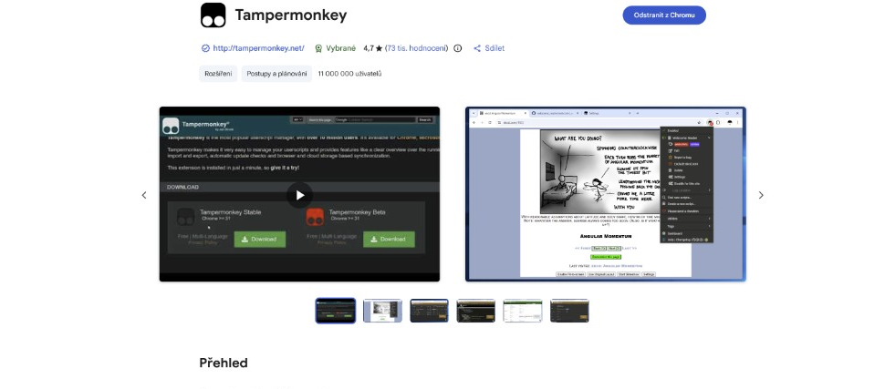
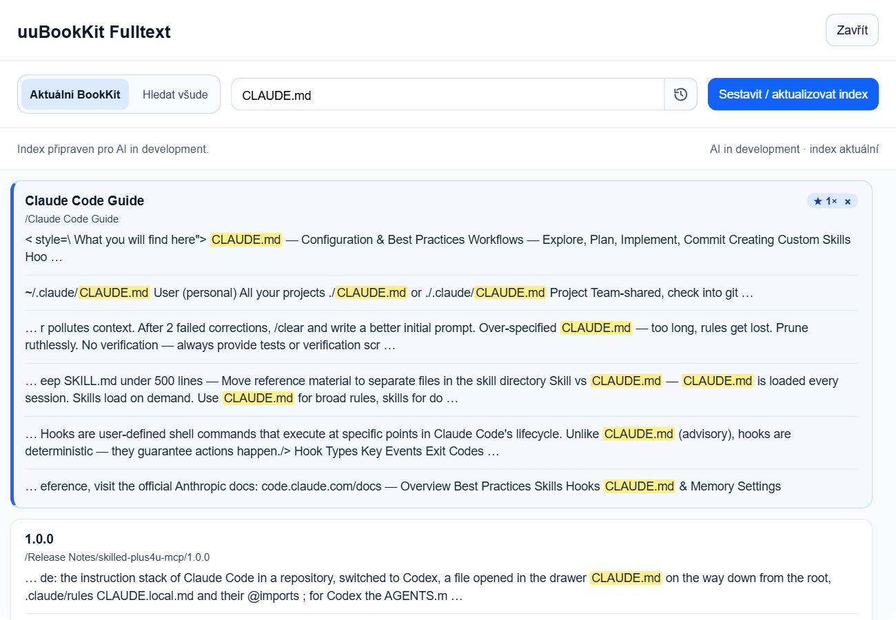
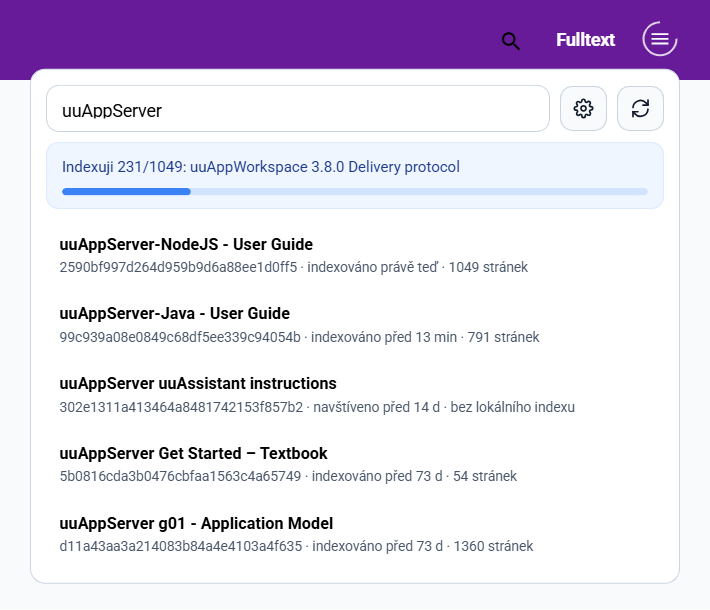
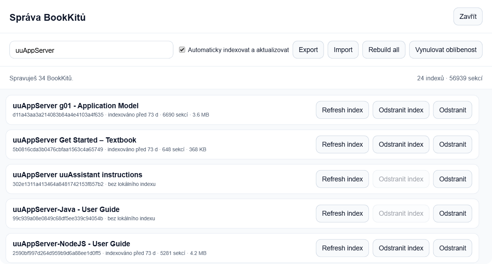

# GreaseMonkey scripts

Small Tampermonkey helpers I use every day — Cursor usage KPIs, BookKit fulltext search, Message Registry previews, uuIdentity login fixes, and more.

Want to try them? Use at your own risk.

**Disclaimer** — these scripts are usually generated with ChatGPT and tested only for my personal purposes.

## What's new

- **2026-10-16 · uuBookKit Fulltext Search 1.9–1.11** – books are indexed automatically on your first visit and an outdated index is refreshed in the background, reloading only changed pages. Pages you open from the search rank higher next time (★ N×). The ☰ book menu spins and shows progress while indexing. [Details](changelogs.md#bookkit-fulltext-searchuserjs)
- **2026-10-16 · IndSoft JIRA - Attachment preview 1.0–1.2** (new) – opens HTML, text, image and PDF attachments in a new tab with its own shareable address; HTML attachments work as live dashboards. Also on Unicorn and ČEPS Jira. [Details](changelogs.md#jira-attachment-previewuserjs)
- **2026-10-15 · WTM ← Jira sync 0.6** – import of the label mapping from the SP53 document, „Zapsat vše“ for the whole month. [Details](changelogs.md#wtm-jira-syncuserjs)

Full history of every script: **[changelogs.md](changelogs.md)**

## Installation

**New to Chrome + Tampermonkey?** Read the short Czech setup guide first:

**[Jak nainstalovat Tampermonkey v Chrome →](HOW-TO-INSTALL-TAMPERMONKEY.md)**

Click an **Install** link below. Tampermonkey should open the install or update prompt directly.

If direct install is blocked by the browser, use the same URL in the addon page:

- Settings (Nastaveni)
- Import from URL

<table>
<thead>
<tr><th align="left">Addon</th><th align="left">Address</th></tr>
</thead>
<tbody>
<tr>
<td>Copy uuBml as PNG to clipboard</td>
<td valign="top"><a href="https://raw.githubusercontent.com/sedlacl/GreaseMonkey/refs/heads/main/uubml-copy-as-png.user.js">Install</a></td>
</tr>
<tr>
<td>Cursor Usage Statistics</td>
<td valign="top"><a href="https://raw.githubusercontent.com/sedlacl/GreaseMonkey/refs/heads/main/cursor-usage-statistics.user.js">Install</a></td>
</tr>
<tr>
<td>

<b>uuBookKit Fulltext Search</b> – fulltext search across BookKit books

 
Works in <code>uu-bookkit-maing01</code> books where the built-in search is too limited. The script keeps its own fulltext index of book pages and sections in the browser, remembers the books you visit and searches one book or all indexed books from one dialog (<b>Fulltext</b> button in the book header).
<ul>
<li><b>Automatic indexing</b> – a book without an index is indexed in the background on your first visit. An outdated index is refreshed on the next visit and only new and changed pages are loaded again; the whole book is reloaded once a day.</li>
<li><b>Preferred results</b> – pages you open from the search rank higher next time and are marked <b>★ N×</b>. The × in the badge resets one page, <b>Vynulovat oblíbenost</b> in the book management resets all.</li>
<li><b>Book menu ☰</b> – switch between known books; while indexing, the icon spins and the menu shows progress.</li>
<li><b>Book management</b> (⚙ in the menu) – refresh or remove an index, export and import the book list, turn automatic indexing off.</li>
</ul>

 Search in the current book – the page opened before is preferred (★ 1×)

 Book menu while a book is being indexed

 Book management

</td>
<td valign="top"><a href="https://raw.githubusercontent.com/sedlacl/GreaseMonkey/refs/heads/main/bookkit-fulltext-search.user.js">Install</a></td>
</tr>
<tr>
<td>Autoclose authentication page</td>
<td valign="top"><a href="https://raw.githubusercontent.com/sedlacl/GreaseMonkey/refs/heads/main/close-auth-page.user.js">Install</a></td>
</tr>
<tr>
<td>Identity login password manager bridge</td>
<td valign="top"><a href="https://raw.githubusercontent.com/sedlacl/GreaseMonkey/refs/heads/main/identity-login-password-manager.user.js">Install</a></td>
</tr>
<tr>
<td>JSONATA JAVA Checker</td>
<td valign="top"><a href="https://raw.githubusercontent.com/sedlacl/GreaseMonkey/refs/heads/main/jsonata-java-checker.user.js">Install</a></td>
</tr>
<tr>
<td>IndSoft JIRA - ManiTime copy tag</td>
<td valign="top"><a href="https://raw.githubusercontent.com/sedlacl/GreaseMonkey/refs/heads/main/indsoft-jira-manictime.user.js">Install</a></td>
</tr>
<tr>
<td>IndSoft JIRA - Attachment preview</td>
<td valign="top"><a href="https://raw.githubusercontent.com/sedlacl/GreaseMonkey/refs/heads/main/jira-attachment-preview.user.js">Install</a></td>
</tr>
<tr>
<td>Message Registry - Auto refresh</td>
<td valign="top"><a href="https://raw.githubusercontent.com/sedlacl/GreaseMonkey/refs/heads/main/message-registry-autorefresh.user.js">Install</a></td>
</tr>
<tr>
<td>Message Registry - Preview downloads</td>
<td valign="top"><a href="https://raw.githubusercontent.com/sedlacl/GreaseMonkey/refs/heads/main/message-registry-preview-downloads.user.js">Install</a></td>
</tr>
<tr>
<td>Message Registry - Preview downloads (UUCloud1)</td>
<td valign="top"><a href="https://raw.githubusercontent.com/sedlacl/GreaseMonkey/refs/heads/main/message-registry-preview-downloads.uucloud1.user.js">Install</a></td>
</tr>
<tr>
<td>uuBookKit – FileManager</td>
<td valign="top"><a href="https://raw.githubusercontent.com/sedlacl/GreaseMonkey/refs/heads/main/bookkit-file-manager.user.js">Install</a></td>
</tr>
<tr>
<td>WTM ← Jira sync</td>
<td valign="top"><a href="https://raw.githubusercontent.com/sedlacl/GreaseMonkey/refs/heads/main/wtm-jira-sync.user.js">Install</a></td>
</tr>
</tbody>
</table>

Rows with ▸ expand to a description and screenshots.

## Notes

Use `Message Registry - Preview downloads` for the standard `uu-energygateway-messageregistryg01` UI.

Use `Message Registry - Preview downloads (UUCloud1)` for the `usy-idsmari-messageregistryg01` / IDS Apps variant. This version keeps the same preview dialogs and formatting tools, but adds compatibility fixes for older UU5 rendering, attachment button placement, and authenticated preview requests.

Use `Identity login password manager bridge` on uuIdentity login pages where password managers do not recognize the original `accessCode1` / `accessCode2` fields. The script decorates the native fields and inserts two compatible proxy password inputs that mirror back into the original form.

Use `Cursor Usage Statistics` on the Cursor usage dashboard to see spend KPIs (today, last 7 days, calendar month, daily average), a stacked chart of the top five models by spend plus others, and a per-model cost table. Toggle the chart between 7 or 30 days and tokens or spend; click a model in the table to filter it in the chart. Tooltips show daily and per-segment details. Included usage remains visible in token totals but counts as $0 spend, matching Cursor's own table.

Use `uuBookKit – FileManager` on the BookKit attachments page to show file sizes on tiles, sort by size, and optionally run a heuristic unused-attachment check across book pages. After a clean scan, `Select candidates` adds heuristically identified unused attachments to the native bulk-action selection. The usage scan may miss non-standard references; partial page failures do not mark attachments as unused.

WTM ← Jira sync (`wtm-jira-sync.user.js`): na stránce WTM „Výkazy za měsíc“ spáruje položky s tvými worklogy v Jiře (`jira.indsoft.local`). Zelená = sedí, oranžová = liší se (tlačítko „Upravit podle Jiry“), virtuální řádek = chybí ve WTM („Zapsat do WTM“, „Zapsat vše“ za den, „Zapsat vše“ v liště za celý měsíc), červená = ve WTM navíc (mažeš ručně). Jira je zdroj pravdy, skript do Jiry nezapisuje a ve WTM nic nemaže. Artefakt WTM se bere z W_ labelu ticketu podle tabulky v Nastavení; tabulku lze naimportovat ze souboru `mappings.toml` (TOML, `schema_version = 1`, pole `label`, `subject_url`, volitelně `valid_to`, `blocked`, `note`, `project`, `artifact`). Label po `valid_to` nebo s `blocked = true` zápis zablokuje. Druhou možností je import přímo z dokumentu „SP53 Standardy vykazování“ v ManagementKitu (tlačítko „Importovat z dokumentu SP53“). Potřebuje být přihlášený do Jiry ve stejném prohlížeči.

Use `IndSoft JIRA - Attachment preview` on IndSoft, Unicorn (`jira.unicorn.com`) and ČEPS (`jira-dc.ceps.cz`) Jira issues to open HTML, text, image and PDF attachments (up to 10 MB) in a new tab via the eye button on the attachment tile (next to the file name in the list view); the preview tab has its own `?viewAttachment=<file name>` address, so it can be reloaded and shared, and it always shows the newest upload of that name. An open preview checks for a newer upload every 30 s while visible and redraws itself, so an HTML attachment works as a live dashboard; Back returns to the issue. HTML dashboards run their scripts in a sandboxed frame without access to Jira; scripts from a CDN are fetched and inlined, because Unicorn Jira's CSP also applies to that frame.

## Changelog

Per-script version history: **[changelogs.md](changelogs.md)**

Repo milestones (legacy):

- 1.0 - initial version
- 1.1 - fix of block element text
- 1.2 - add message detail download preview userscript
- 1.3 - add preview format button for JSON and XML payloads
- 1.4 - add message registry auto refresh userscript
- 1.5 - add UUCloud1-specific message registry preview downloads variant
- 1.6 - add uuIdentity login password manager bridge
- 1.7 - add uuBookKit fulltext search userscript
- 1.8 - add uuBookKit FileManager userscript (sizes, sort, heuristic usage check)
